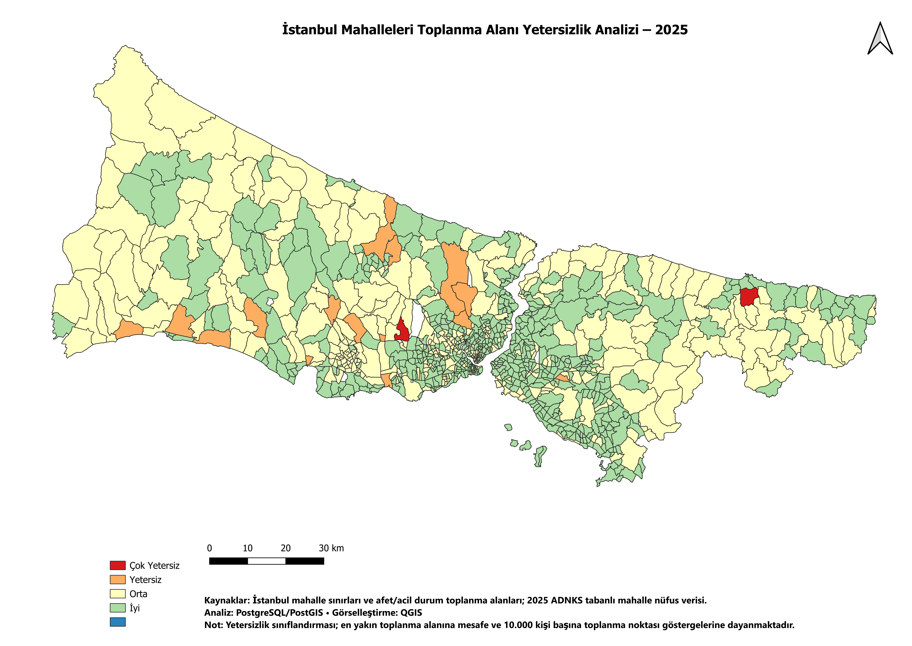
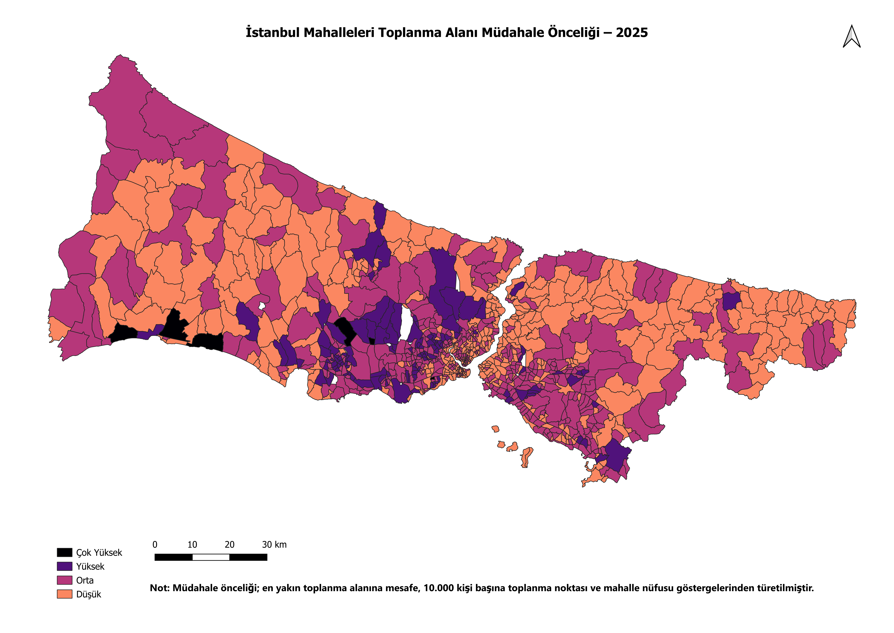

# Istanbul Emergency Assembly Area Accessibility Analysis

A neighborhood-level spatial analysis of **emergency assembly area accessibility and intervention priority across Istanbul** using **PostgreSQL/PostGIS, QGIS, Python, GeoPandas, and Folium**.

The project evaluates whether Istanbul neighborhoods have sufficient access to designated emergency assembly points and identifies areas that may require higher intervention priority when population pressure is also considered.

🌐 **[View Interactive Map](https://elifaltunsu.github.io/istanbul-earthquake-assembly-analysis/)**

---

## Project Overview

Following a major earthquake or other emergency, residents need to reach designated assembly areas quickly and safely.

This project analyzes emergency assembly area accessibility across Istanbul at the neighborhood level by combining:

- Neighborhood boundaries
- 2025 neighborhood population
- 5,599 emergency assembly area points
- Distance to the nearest assembly point
- Number of assembly points within each neighborhood
- Assembly point availability relative to population

Two final outputs were produced:

1. **Assembly Area Inadequacy Analysis**  
   Evaluates physical accessibility and assembly point availability.

2. **Intervention Priority Analysis**  
   Combines inadequacy with neighborhood population to identify areas where deficiencies may affect more residents.

---

## Key Results

The final analysis covers:

- **963 neighborhoods**
- **39 districts**
- **15,753,753 residents**
- **5,599 unique emergency assembly points**

### Assembly Area Inadequacy

| Classification | Neighborhoods |
|---|---:|
| Good | 583 |
| Moderate | 361 |
| Inadequate | 17 |
| Highly Inadequate | 2 |

### Intervention Priority

| Priority | Neighborhoods |
|---|---:|
| Low | 420 |
| Moderate | 422 |
| High | 115 |
| Very High | 6 |

The intervention priority model provides a different perspective from the physical inadequacy analysis.

A neighborhood may not have the worst physical accessibility score, but it can still receive a high intervention priority if a large population is affected.

---

## Final Maps

### Assembly Area Inadequacy Analysis



The inadequacy score is based on:

- Distance to the nearest emergency assembly point
- Number of assembly points per 10,000 residents

---

### Intervention Priority Analysis



The intervention priority model additionally incorporates neighborhood population to identify areas where accessibility limitations may affect larger numbers of residents.

---

## Interactive Map

An interactive web map was created using **Python, GeoPandas, and Folium**.

Users can:

- Search neighborhoods
- Switch between inadequacy and intervention priority layers
- Zoom into individual neighborhoods
- Inspect population and assembly area statistics
- View neighborhood-level classification results

🌐 **[Open Interactive Map](YOUR_GITHUB_PAGES_URL)**

The interactive map is published as a static website through **GitHub Pages**, so no backend or database connection is required for end users.

---

## Methodology

The project follows the workflow below:

```text
Raw Spatial Data
        |
        v
QGIS Data Inspection
        |
        v
Geometry & CRS Validation
        |
        v
PostgreSQL + PostGIS
        |
        +-- Neighborhood / population matching
        |
        +-- Spatial assignment of assembly points
        |
        +-- Nearest-neighbor analysis
        |
        +-- Accessibility metrics
        |
        +-- Inadequacy scoring
        |
        +-- Intervention priority scoring
        |
        v
QGIS Final Cartographic Outputs
        |
        v
GeoJSON Export
        |
        v
Python + GeoPandas + Folium
        |
        v
GitHub Pages Interactive Map
```

---

## Data Preparation

Several data quality issues were handled before the spatial analysis.

### Coordinate Reference System

The original neighborhood geometry contained coordinates corresponding to **EPSG:3857**, although the dataset had been labeled differently.

The geometries were corrected and transformed to:

```text
EPSG:32635
WGS 84 / UTM Zone 35N
```

This projected CRS was used for spatial distance calculations in meters.

---

### Neighborhood Matching

The spatial dataset and the 2025 population dataset did not use identical neighborhood naming conventions.

The matching process included:

- Case normalization
- Turkish character normalization
- Whitespace normalization
- Manual mappings for historical or alternative neighborhood names

The initial matching resulted in:

```text
944 exact matches
16 manually resolved matches
```

Three neighborhoods required updated boundary geometries:

- Esenler — 15 Temmuz
- Esenyurt — Merkez
- Eyüpsultan — 5. Levent

Updated OpenStreetMap boundaries were used for **Esenler, Esenyurt, and Eyüpsultan**, resulting in a final dataset of:

```text
963 / 963 neighborhoods
```

---

## Assembly Point Validation

The assembly area dataset contains:

```text
5,599 records
5,599 unique OBJECTIDs
0 duplicate OBJECTIDs
```

Each assembly point was assigned to exactly one final neighborhood.

Most records matched directly through spatial containment.

A small number of boundary exceptions were resolved through deterministic nearest-neighborhood assignment.

Final assignment methods include:

- `spatial_exact`
- `boundary_resolved`
- `nearest_fallback`

This ensured that all 5,599 assembly points were counted exactly once.

---

## Spatial Metrics

### Assembly Point Count

The number of assembly points located within each neighborhood was calculated using PostGIS spatial operations.

### Nearest Assembly Point Distance

A representative point was generated inside each neighborhood using:

```sql
ST_PointOnSurface()
```

Nearest-neighbor search was performed using the PostGIS KNN operator:

```sql
<->
```

The final distance was calculated using:

```sql
ST_Distance()
```

Since the analysis uses EPSG:32635, distances are expressed in **meters**.

---

### Assembly Point Availability

Because the source dataset contains assembly locations as **points rather than polygons**, actual assembly area capacity in square meters could not be calculated.

Instead, the following indicator was used:

```text
Assembly Points
---------------- × 10,000
Population
```

This metric represents:

**Assembly points per 10,000 residents**

It should not be interpreted as physical area capacity.

---

## Inadequacy Score

Two indicators are used.

### Distance Score

| Distance | Score |
|---|---:|
| ≤ 500 m | 0 |
| 500–1,000 m | 1 |
| 1,000–2,000 m | 2 |
| > 2,000 m | 3 |

### Assembly Point Availability Score

Population-adjusted availability thresholds are derived dynamically from the distribution of assembly points per 10,000 residents.

The first quartile and median are used instead of fixed arbitrary thresholds.

The final score is:

```text
Inadequacy Score
=
Distance Score
+
Availability Score
```

Resulting classification:

| Score | Classification |
|---|---|
| 0–1 | Good |
| 2–3 | Moderate |
| 4 | Inadequate |
| 5–6 | Highly Inadequate |

---

## Intervention Priority

Physical inadequacy alone does not indicate how many residents are affected.

For this reason, a population score was added.

Neighborhood population was divided into quartile-based classes.

```text
Intervention Priority Score
=
Inadequacy Score
+
Population Score
```

Resulting classification:

| Score | Priority |
|---|---|
| 0–2 | Low |
| 3–4 | Moderate |
| 5–6 | High |
| 7–9 | Very High |

This allows densely populated neighborhoods with moderate physical deficiencies to receive greater intervention priority.

---

## Technology Stack

### Spatial Analysis

- PostgreSQL
- PostGIS
- QGIS

### Data Processing

- Python
- GeoPandas

### Interactive Visualization

- Folium
- Leaflet.js

### Deployment

- GitHub
- GitHub Pages

---

## SQL Pipeline

The analysis is divided into three main SQL scripts.

### `01_prepare_data.sql`

Responsible for:

- CRS validation and documentation
- Istanbul filtering
- Population integration
- Neighborhood name normalization
- Updated neighborhood geometries
- Final 963-neighborhood dataset

### `02_build_analysis.sql`

Responsible for:

- Assembly point validation
- Neighborhood assignment
- Assembly point counts
- Nearest-neighbor calculations
- Population-adjusted availability metrics

### `03_create_scoring_views.sql`

Responsible for:

- Inadequacy scoring
- Population scoring
- Intervention priority classification
- Final materialized views used by QGIS and the web map

---

## Data Sources

The project combines multiple spatial and demographic sources.

- Istanbul neighborhood boundary data
- Istanbul emergency assembly area inventory
- 2025 neighborhood-level population data
- OpenStreetMap neighborhood boundaries for selected updated districts

Neighborhood names and end-user map labels are kept in **Turkish** to preserve consistency with the original data sources and local context.

## Run Locally

Create a Python environment and install dependencies:

```bash
pip install -r requirements.txt
```

Generate the interactive map:

```bash
python generate_map.py
```

Start a local web server:

```bash
python -m http.server 8000
```

Then open:

```text
http://localhost:8000/docs/
```

---

## Limitations

This project should not be interpreted as a complete earthquake risk assessment.

The analysis focuses specifically on **emergency assembly point accessibility and population-based intervention priority**.

Additionally, the population-adjusted metric uses residential population. Areas such as industrial zones may have low registered residential populations but significantly larger daytime populations.

---

## Future Improvements

Potential extensions include:

- Walking-distance analysis using the road network
- Assembly area polygon/capacity data
- Building-level population distribution
- Seismic hazard layers
- Ground condition and liquefaction layers
- Accessibility under road disruption scenarios
- Daytime population estimates
- Public transportation and evacuation network analysis

---

## Author

Spatial data analysis project developed using PostgreSQL/PostGIS, QGIS, and Python.

If you use or extend this project, please reference the original data providers and verify the latest available spatial and demographic datasets.
